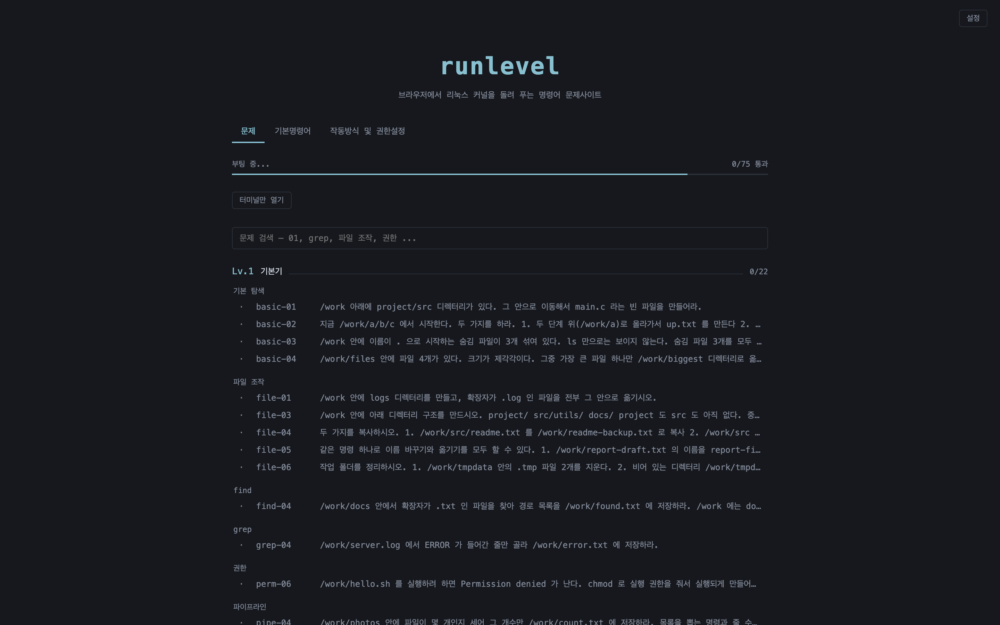

<h1 align="center">runlevel</h1>

<p align="center">
  브라우저 탭 안에서 진짜 리눅스를 띄워 셸 명령을 연습합니다.
</p>

<p align="center">
  <a href="https://runlevel.cc"><b>runlevel.cc</b></a> — 설치도 가입도 없습니다.
</p>

<p align="center">
  
</p>

---

서버에 접속하는 사이트가 아닙니다. x86 에뮬레이터 [v86](https://github.com/copy/v86)이 탭 안에서 Linux 커널과 Alpine을 그대로 실행합니다. `ls`를 치면 진짜 `ls` 바이너리가 돌고, `fdisk`로 가상 디스크의 파티션을 실제로 나눌 수 있습니다. 탭을 닫으면 그 리눅스는 통째로 사라지므로 `rm -rf /`를 쳐 봐도 됩니다. 궁금해서 쳐 보는 사람이 꼭 있는데, 새로고침하면 돌아옵니다.

커널 부팅을 기다리게 하고 싶지 않아서, 부팅이 끝난 순간의 메모리를 통째로 저장해 두고 그걸 복원합니다. 첫 방문에 약 25MB를 받고, 다음부터는 브라우저 캐시를 씁니다.

## 문제

75개쯤 됩니다. 기본 탐색부터 시작해서 이런 범위를 다룹니다.

| 영역 | 내용 |
|---|---|
| 기본 | 디렉터리 이동, 파일 조작, 리다이렉션, 파이프라인 |
| 텍스트 | `grep`, `sed`, `awk`, `sort`, `uniq`, `find` |
| 권한 | `chmod`, `chgrp`, umask, sticky bit, SUID, `sudo` |
| 스크립트 | 인자, 조건문, 종료 코드 |
| 프로세스 | `ps`, `kill` |
| 네트워크 | `ip`, `ping`, `netstat`, `nmap` (게스트 안의 가상 호스트 대상) |
| 디스크 | `fdisk`, `mkfs`, `mount`, `/etc/fstab` |

man 페이지는 이미지에 넣지 않았습니다(스냅샷 용량이 빠듯합니다). 대신 이 환경에서 하나하나 실행해 확인한 [명령어 사전](https://runlevel.cc/cmd/)이 있습니다.

## 채점

입력한 명령어를 정답 문자열과 비교하지 않습니다. 명령을 칠 때마다 "시스템이 원하는 상태가 됐는지"를 게스트 안에서 확인합니다. 그래서 어떤 길로 갔든 결과만 맞으면 통과입니다.

채점 명령은 사용자 터미널(ttyS0)과 분리된 두 번째 시리얼 포트(ttyS1)로 들어가므로 화면에 보이지 않습니다.

문제는 일반 계정(`student`)으로 풉니다. 처음에는 root였는데, root는 권한 검사를 통째로 건너뛰어서 `chmod 000`을 걸어둔 파일이 그냥 읽혔습니다. 그걸 보고 전부 바꿨습니다.

## 로컬 실행

Node.js가 필요합니다. 게스트 이미지는 용량 때문에 저장소에 없어서, 배포본에서 받아옵니다.

```sh
mkdir -p spike/images && cd spike/images
curl -O https://runlevel.cc/img/state.bin.zst
curl -O https://runlevel.cc/img/seabios.bin
curl -O https://runlevel.cc/img/vgabios.bin
cd ../..
```

```sh
cd web
npm install
npm start          # http://localhost:8080
npm run build      # 정적 배포용 dist/ 생성
npm run preview    # dist/ 를 :8081 에서 확인
```

이미지를 처음부터 만들려면 `spike/`에서 `alpine-build.mjs` → `add-packages.mjs` → `finalize-image.mjs` → `make-snapshot.mjs` 순서로 돌립니다.

## 문제 추가

`problems/<카테고리>/<id>.yaml` 파일 하나를 만들면 코드 수정 없이 목록에 올라갑니다.

```sh
cp docs/problem-template.yaml problems/t1-text/text-11.yaml
cd spike && node lint-problems.mjs
```

작성 요령과 자주 틀리는 부분은 [docs/making-problems.md](docs/making-problems.md)에 있습니다.

## 구조

| 경로 | 내용 |
|---|---|
| `web/` | 프론트엔드. `vm.js`가 게스트를 몰고, `problems.js`가 채점하고, `main.js`가 UI |
| `problems/` | 문제 정의. 문제 하나가 YAML 하나 |
| `spike/` | 게스트 이미지 빌드 스크립트와 테스트 도구 |
| `api/` | 풀이 기록을 모으는 Cloudflare Worker + D1. 신원 정보는 안 받습니다 |
| `docs/` | 문제 작성 문서 |

## 라이선스

[MIT](LICENSE). `web/vendor/`의 v86(BSD-2-Clause), xterm.js(MIT), js-yaml(MIT)은 각자의 라이선스를 따릅니다.
