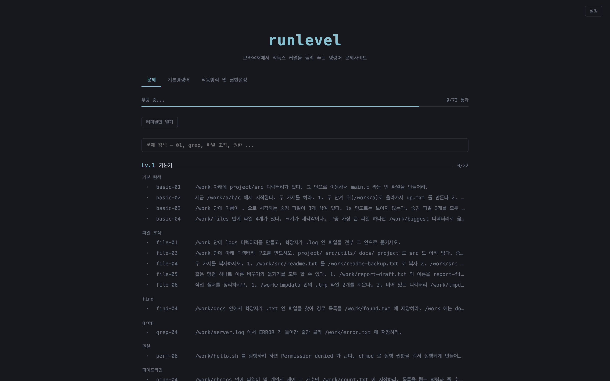

# runlevel

브라우저 안에서 실제 리눅스를 띄워 셸 명령을 연습하는 사이트입니다.

**https://runlevel.cc**



서버에 접속하는 방식이 아닙니다. x86 에뮬레이터 [v86](https://github.com/copy/v86)이
브라우저 탭 안에서 Linux 커널과 Alpine 유저랜드를 그대로 실행합니다.
`ls`를 치면 실제 `ls` 바이너리가 실행되고, `fdisk`나 `mount`도 가상 디스크에 실제로 동작합니다.
설치나 가입 없이 페이지를 열면 바로 쓸 수 있습니다.

## 다루는 범위

| 영역 | 내용 |
|---|---|
| 기본 | 디렉터리 이동, 파일 조작, 리다이렉션, 파이프라인 |
| 텍스트 | `grep`, `sed`, `awk`, `sort`, `uniq`, `find` |
| 권한 | `chmod`, `chgrp`, umask, sticky bit, SUID, `sudo` |
| 스크립트 | 인자, 조건문, 종료 코드 |
| 프로세스 | `ps`, `kill` |
| 네트워크 | `ip`, `ping`, `netstat`, `nmap` (게스트 내부 가상 호스트 대상) |
| 디스크 | `fdisk`, `mkfs`, `mount`, `/etc/fstab` |

문제는 70개 남짓이고, 명령어 사전 페이지도 함께 있습니다.

## 채점 방식

입력한 명령어 문자열을 정답과 비교하지 않습니다. 명령을 실행할 때마다
"시스템이 원하는 상태가 됐는지"를 게스트 안에서 확인합니다.
같은 결과에 도달하는 방법이 여러 가지면 어느 쪽이든 통과합니다.

채점은 사용자 터미널(ttyS0)과 분리된 두 번째 시리얼 포트(ttyS1)에서 돌기 때문에
화면에는 보이지 않습니다.

문제는 기본적으로 일반 계정(`student`)으로 풉니다. root로 풀면 권한 검사를
전부 건너뛰어서 권한 문제가 의미가 없어지기 때문입니다.

## 구조

| 경로 | 내용 |
|---|---|
| `web/` | 프론트엔드. `vm.js`가 게스트를 제어하고, `problems.js`가 채점하고, `main.js`가 UI |
| `problems/` | 문제 정의. 문제 하나가 YAML 파일 하나 |
| `spike/` | 게스트 이미지 빌드 스크립트와 테스트 도구 |
| `api/` | 풀이 결과를 모으는 Cloudflare Worker + D1 |
| `docs/` | 설계 문서 |

첫 방문 때 받는 데이터는 약 25MB입니다. 대부분은 부팅이 끝난 상태를 저장한
스냅샷이고, 이걸 복원하기 때문에 커널 부팅을 기다리지 않습니다.
이후에는 브라우저 캐시를 씁니다.

## 로컬 실행

Node.js가 필요합니다.

게스트 이미지는 용량 때문에 저장소에 없습니다. 배포본에서 받아 `spike/images/`에 넣습니다.

```sh
mkdir -p spike/images && cd spike/images
curl -O https://runlevel.cc/img/state.bin.zst
curl -O https://runlevel.cc/img/seabios.bin
curl -O https://runlevel.cc/img/vgabios.bin
cd ../..
```

```sh
cd web
npm install
npm start          # http://localhost:8080
npm run build      # 정적 배포용 dist/ 생성
npm run preview    # dist/ 를 :8081 에서 확인
```

이미지를 처음부터 만드는 방법은 [docs/spike-results.md](docs/spike-results.md)에 있습니다.

## 문제 추가

`problems/<카테고리>/<id>.yaml` 파일을 하나 만들면 코드 수정 없이 목록에 추가됩니다.

```sh
cp docs/problem-template.yaml problems/t1-text/text-11.yaml
cd spike && node lint-problems.mjs
```

스키마는 [docs/problem-schema.md](docs/problem-schema.md),
작성 방법과 자주 틀리는 부분은 [docs/making-problems.md](docs/making-problems.md)에 정리돼 있습니다.

## 문서

- [docs/how-it-works.md](docs/how-it-works.md) — 전체 동작 방식
- [docs/engine-research.md](docs/engine-research.md) — 실행 엔진을 v86으로 정한 이유
- [docs/spike-results.md](docs/spike-results.md) — 이미지 빌드 과정과 측정 결과
- [docs/privacy.md](docs/privacy.md) — 수집하는 데이터

## 라이선스

[MIT](LICENSE). `web/vendor/`에 포함된 v86(BSD-2-Clause), xterm.js(MIT), js-yaml(MIT)은 각자의 라이선스를 따릅니다.
